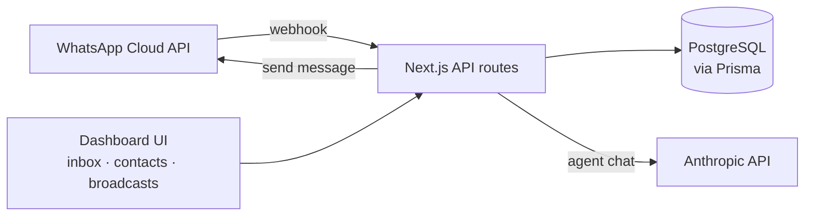

<div align="center">

# WhatsApp Business Platform

A multi-tenant WhatsApp Business operations platform: team inbox, contact CRM, template
broadcasts, AI auto-reply agents with governance, and analytics.


</div>

## Table of contents

- [Features](#features)
- [Architecture](#architecture)
- [Tech stack](#tech-stack)
- [Getting started](#getting-started)
- [Environment variables](#environment-variables)
- [WhatsApp webhook](#whatsapp-webhook)
- [Project structure](#project-structure)
- [Data model](#data-model)
- [Scripts](#scripts)
- [Security](#security)
- [License](#license)

## Features

- **Team inbox**: shared conversations, internal notes, quick replies and working hours
- **Contacts CRM**: tags and custom fields for segmentation
- **Broadcasts**: send approved templates to contact segments and track delivery
- **AI agents**: Claude-powered agents configured in a visual bot studio, with a chat endpoint
- **Governance**: audit log of agent actions with confidence scores, escalations and blocks
- **Analytics**: conversation and broadcast metrics
- **Auth and teams**: JWT session cookies, organisations and roles

## Architecture



Inbound messages arrive at `/api/whatsapp/webhook` and are stored through Prisma. Team
members reply through `/api/whatsapp/send`, and AI agents generate replies through
`/api/ai-agents/chat`.
More detail is in [docs/architecture.md](docs/architecture.md).

## Tech stack

| Layer     | Technology                              |
| --------- | --------------------------------------- |
| Framework | Next.js (App Router), React, TypeScript |
| Styling   | Tailwind CSS 4                          |
| Database  | PostgreSQL with Prisma ORM              |
| Auth      | JWT sessions with `jose` and `bcryptjs` |
| AI        | Anthropic SDK                           |
| Messaging | WhatsApp Cloud API                      |

## Getting started

**Prerequisites:** Node.js 20+, a PostgreSQL database, a Meta developer app with the
WhatsApp Cloud API enabled, and an Anthropic API key for the AI agents.

```bash
git clone https://github.com/gitswagata1/whatsapp-business-platform.git
cd whatsapp-business-platform
npm install
cp .env.example .env          # fill in the values below
npx prisma migrate dev
npm run db:seed               # loads demo data
npm run dev                   # http://localhost:3000
```

The seed creates a demo organisation and an admin user `admin@example.com` whose password
comes from `SEED_ADMIN_PASSWORD`.

## Environment variables

| Variable                        | Purpose                                         |
| ------------------------------- | ----------------------------------------------- |
| `DATABASE_URL`                  | PostgreSQL connection string                    |
| `NEXTAUTH_SECRET`               | Secret used to sign session tokens (required)   |
| `NEXTAUTH_URL`                  | Public base URL of the app                      |
| `WHATSAPP_ACCESS_TOKEN`         | WhatsApp Cloud API access token                 |
| `WHATSAPP_PHONE_NUMBER_ID`      | Sending phone number ID                         |
| `WHATSAPP_BUSINESS_ACCOUNT_ID`  | WhatsApp Business account ID                    |
| `WHATSAPP_WEBHOOK_VERIFY_TOKEN` | Token used to verify the webhook                |
| `ANTHROPIC_API_KEY`             | Key for the AI agents                           |
| `SEED_ADMIN_PASSWORD`           | Password of the demo admin created by the seed  |

Generate a session secret with `openssl rand -base64 32`.

## WhatsApp webhook

In the Meta developer console, set the callback URL to
`https://<your-domain>/api/whatsapp/webhook` and use the value of
`WHATSAPP_WEBHOOK_VERIFY_TOKEN` as the verify token. For local development, expose port
3000 with a tunnel such as `ngrok`.

## Project structure

```
whatsapp-business-platform/
├── docs/
│   └── architecture.md          Request flow and design notes
├── prisma/
│   ├── schema.prisma            Database schema
│   └── seed.ts                  Demo data
├── src/
│   ├── app/
│   │   ├── (auth)/              Login and register pages
│   │   ├── (dashboard)/         Inbox, contacts, broadcasts, AI agents,
│   │   │                        bot studio, governance, analytics, settings
│   │   └── api/                 REST routes and the WhatsApp webhook
│   ├── components/layout/       Sidebar and dashboard shell
│   ├── hooks/                   Client state (zustand store)
│   ├── lib/
│   │   ├── auth.ts              Session creation and verification
│   │   ├── prisma.ts            Prisma client singleton
│   │   ├── secret.ts            Session-signing key loader
│   │   ├── utils.ts
│   │   └── whatsapp.ts          WhatsApp Cloud API client
│   ├── middleware.ts            Route protection
│   └── types/
├── .env.example
├── LICENSE
└── README.md
```

## Data model

Core Prisma models: `Organization`, `User`, `WhatsAppAccount`, `Contact`, `Tag`,
`CustomFieldDef`, `Conversation`, `Message`, `Note`, `Template`, `Broadcast`,
`BroadcastRecipient`, `AIAgent`, `QuickReply` and `WorkingHours`.

## Scripts

| Command              | Description                      |
| -------------------- | -------------------------------- |
| `npm run dev`        | Start the development server     |
| `npm run build`      | Generate Prisma client and build |
| `npm run start`      | Run the production build         |
| `npm run lint`       | Run ESLint                       |
| `npm run db:migrate` | Run database migrations          |
| `npm run db:seed`    | Seed demo data                   |

## Security

- The app refuses to start without `NEXTAUTH_SECRET`; there is no default key.
- Passwords are hashed with bcrypt. Never commit `.env` files.
- Protected routes are enforced in `src/middleware.ts`; only login, register and the
  webhook are public.

## License

Released under the [MIT License](LICENSE).

---

Built by **Swagata Banerjee** · [GitHub](https://github.com/gitswagata1)
